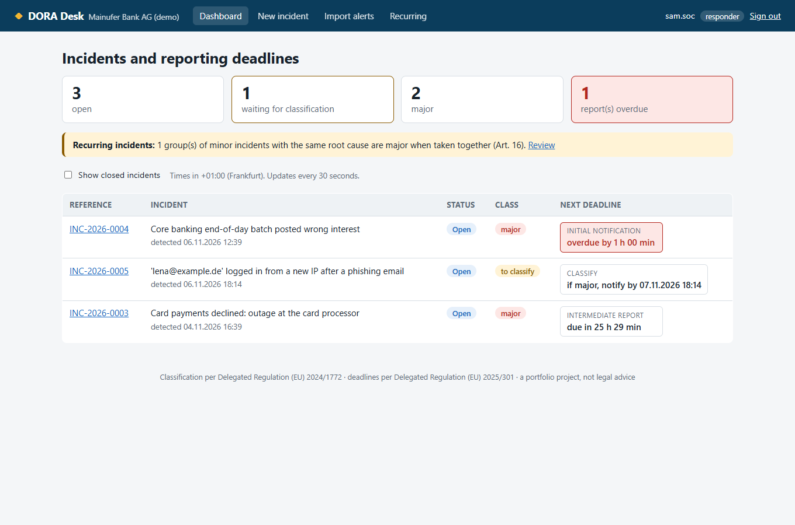
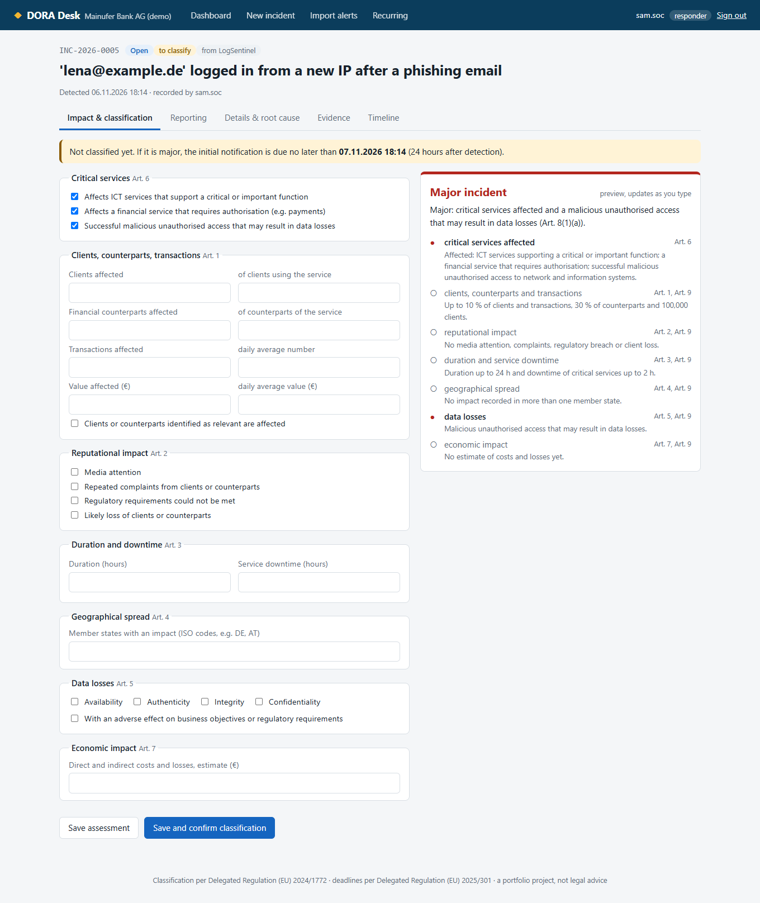
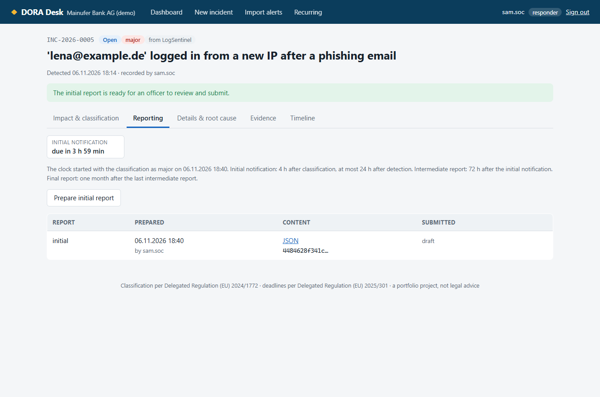
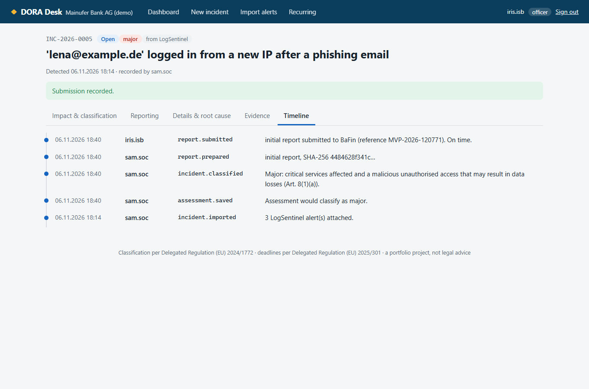
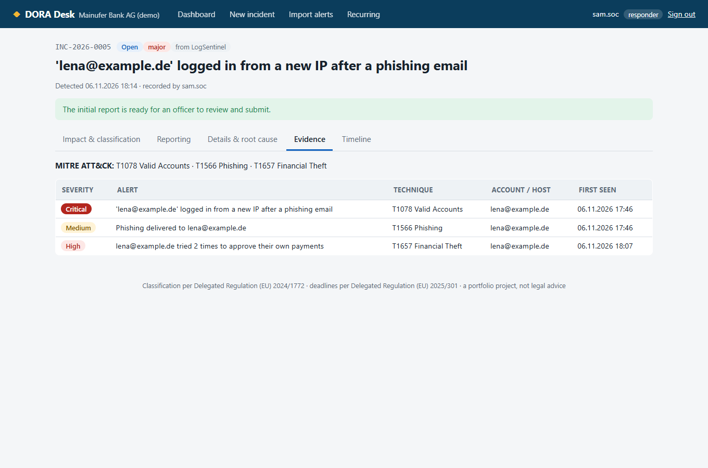
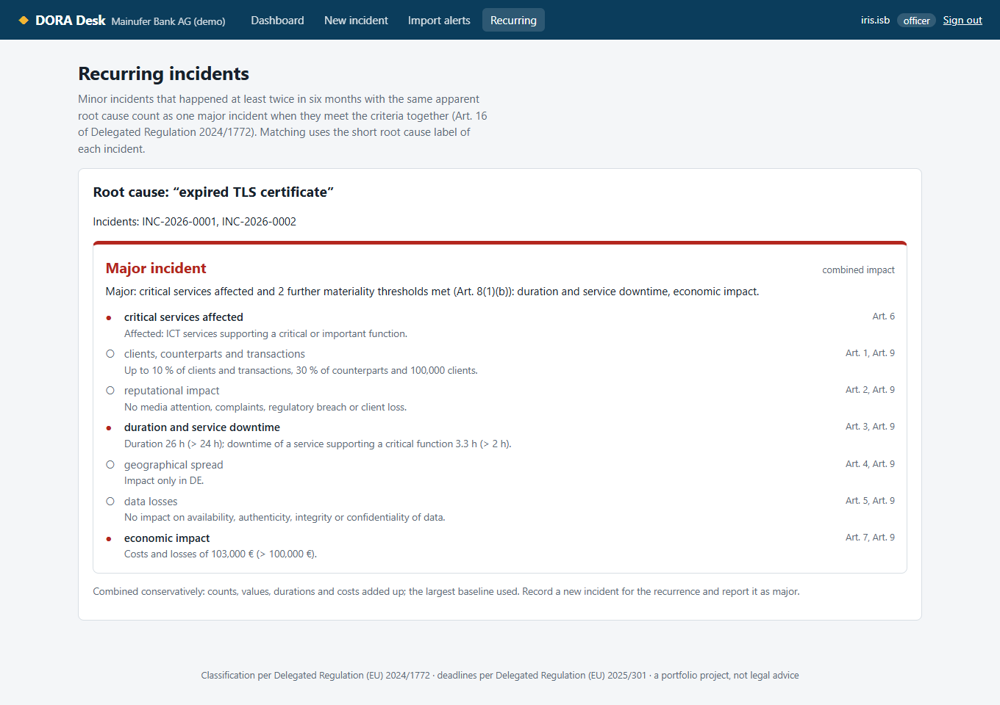
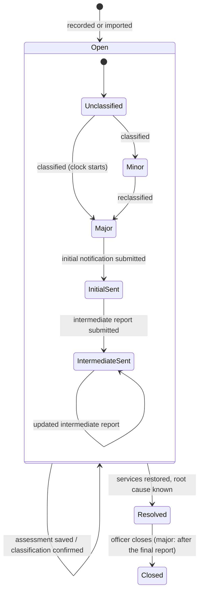

# DORA Desk

**ICT incident management for financial entities under DORA, in Blazor and ASP.NET Core 10: record an incident, assess its
impact, classify it with the EU criteria, and keep every reporting deadline to the supervisor, with the four-eyes
principle on each report.**



> 🇩🇪 **Kurzbeschreibung:** DORA Desk ist ein Werkzeug für das IKT-Vorfallmanagement nach dem Digital Operational
> Resilience Act (DORA, seit 17.01.2025 anwendbar). Vorfälle werden erfasst, ihre Auswirkungen anhand der sieben Kriterien
> der Delegierten Verordnung (EU) 2024/1772 bewertet und als schwerwiegend oder nicht eingestuft, mit Begründung je
> Kriterium. Für schwerwiegende Vorfälle laufen die Meldefristen an die BaFin (Erstmeldung 4 Stunden nach Einstufung,
> spätestens 24 Stunden nach Kenntnis; Zwischenmeldung nach 72 Stunden; Abschlussmeldung nach einem Monat) live auf dem
> Dashboard. Meldungen werden nach dem Vier-Augen-Prinzip erstellt und freigegeben, wiederkehrende Vorfälle mit gleicher
> Ursache werden erkannt (Art. 16), und Alarme aus LogSentinel lassen sich als Beweismittel importieren.

---

## Why this project

Since January 2025 every bank, insurer, payment institution and investment firm in the EU must classify its ICT incidents
and report the major ones to its supervisor within hours (Regulation (EU) 2022/2554, "DORA", Art. 17 to 19). In Frankfurt
that means BaFin and, for the largest banks, the ECB. The rules are precise: seven criteria with numeric thresholds, a
decision rule, and a chain of deadlines where each clock starts when the previous report goes out.

That is exactly the kind of logic that goes wrong in a spreadsheet at 3 a.m. during an outage. DORA Desk turns the
regulation into code that explains itself, and connects it to the detection side: my
[LogSentinel](https://github.com/karicamar/log-sentinel) SIEM finds the attack, DORA Desk decides whether it has to be
reported and tracks the deadline.

| Rule | Source | Where |
|---|---|---|
| Major = critical services affected **and** (malicious access that may cause data loss **or** ≥ 2 further thresholds) | Delegated Reg. 2024/1772, Art. 8 | [`Classifier`](src/DoraDesk.Domain/Classification/Classifier.cs) |
| Thresholds: > 10 % or > 100,000 clients, > 30 % of counterparts, > 10 % of daily transactions (number or value), relevant clients; any reputational impact; > 24 h duration or > 2 h downtime of a critical service; ≥ 2 member states; data impact with adverse effect; > 100,000 € costs | Art. 1 to 7, Art. 9 | [`Classifier`](src/DoraDesk.Domain/Classification/Classifier.cs) |
| Recurring incidents: ≥ 2 in six months, same apparent root cause, together over the thresholds | Art. 16 | [`Recurrence`](src/DoraDesk.Domain/Classification/Recurrence.cs) |
| Initial notification 4 h after classification, at most 24 h after detection; intermediate 72 h after the initial notification; final one month after the last intermediate report | Delegated Reg. 2025/301, Art. 5 | [`Deadlines`](src/DoraDesk.Domain/Reporting/Deadlines.cs) |
| Report content: general information, initial, intermediate and final sections, each repeating the earlier ones | Implementing Reg. 2025/302 (templates) | [`IncidentReport`](src/DoraDesk.Domain/Reporting/IncidentReport.cs) |
| The reporting entity is identified by a valid LEI (ISO 17442, MOD 97-10 check digits) | ITS templates | [`Lei`](src/DoraDesk.Domain/Reporting/Lei.cs) |
| A person confirms every classification; the first "major" starts the clock and a later downgrade does not stop it | DORA Art. 18, 19 | [`ClassifyAsync`](src/DoraDesk.Web/Services/IncidentService.cs) |
| Four-eyes principle: who prepares a report cannot submit it; reports of outdated facts are refused | internal control (MaRisk: segregation of duties) | [`SubmitReportAsync`](src/DoraDesk.Web/Services/IncidentService.cs) |
| A major incident is closed only after the final report; every incident only with a root cause | DORA Art. 17 | [`CloseAsync`](src/DoraDesk.Web/Services/IncidentService.cs) |

## Quick start

```bash
git clone https://github.com/karicamar/dora-desk && cd dora-desk
dotnet run --project src/DoraDesk.Web      # http://localhost:5090, a fictional bank with five incidents
```

Sign in as one of the demo users (no passwords; this list only exists in the development configuration):

| User | Role | Can |
|---|---|---|
| Sam | responder (SOC analyst) | record incidents, import alerts, assess, classify, prepare reports |
| Iris, Jonas | officer (Informationssicherheitsbeauftragte/r) | everything above, submit reports, close incidents |
| Ana | auditor | read everything, change nothing |

The demo data is relative to the current time, so every deadline on the dashboard is live: an initial notification that
is one hour overdue, a card processor outage whose intermediate report is due tomorrow, a fresh phishing incident from
LogSentinel to classify yourself, and two minor certificate outages that together are major.

With Docker: `docker build -t dora-desk . && docker run -p 8080:8080 -e ASPNETCORE_ENVIRONMENT=Development dora-desk`.

## A walk through one incident

**1. Assess and classify.** Every criterion is a group of fields, and the classification on the right updates as you type,
with the reason and the article for each criterion. Saving the assessment and confirming the classification are separate
steps: the regulation puts the decision on the entity, so a person makes it and the timeline records who.



**2. Report.** Once an incident is major, the deadline chain appears. A responder prepares the report (a JSON snapshot
with a SHA-256 hash); the page lists the fields still missing for that report type.



**3. Submit, with four eyes.** An officer who did not prepare the report records the submission with the portal's
reference. If the incident changed after the report was built, the submission is refused: the authority must get the
facts as they are now. An attempt to submit one's own report is refused and written to the timeline.



**Evidence from LogSentinel.** The import reads LogSentinel's JSON alerts (here: a phishing email, a login from a new IP,
then attempts to approve one's own transfers in [Kontor](https://github.com/karicamar/kontor)), keeps them as evidence and
gives hints in DORA terms ("signs of successful unauthorised access: check the data-loss criterion, Art. 8(1)(a)"). It
never classifies on its own.



**Recurring incidents.** Two certificate outages, 14 h and 12 h, 55,000 € and 48,000 €: each one is minor, but together they
exceed 24 hours and 100,000 €.



## How it is built



- **Domain** (`DoraDesk.Domain`): the classification, recurrence, deadlines, LEI and report content. No framework, no
  database, no clock: every function takes the time as a parameter, so the tests can probe each threshold exactly
  ("10 % is not more than 10 %").
- **Web** (`DoraDesk.Web`): Blazor with interactive server rendering, EF Core with SQLite, cookie authentication.
  `IncidentService` holds the workflow: each change runs in one transaction with its timeline entry, checks the actor's
  role, and refuses to overwrite a newer version of the incident (optimistic concurrency with a version number, so two
  people editing the same incident get a clear "reload" instead of losing each other's changes).
- **Time**: stored and reported in UTC, shown in Frankfurt time (`Europe/Berlin`, including the switch to summer time).
  The app uses `TimeProvider`, so tests run against a fake clock and the dashboard can be tested at any moment of a deadline.

## Security

- **Sign-in**: OpenID Connect against the bank's identity provider (for example Microsoft Entra ID, with app roles
  `responder`, `officer`, `auditor`) when `Auth:Oidc` is configured; authorization code flow with PKCE. The passwordless
  demo login exists only when `Desk:DemoLogin` is on, which is the case only in the development configuration.
- **Authorization**: every page and endpoint requires a signed-in user (fallback policy); roles are checked again inside
  the service, so a hidden button is never the only protection. The auditor role cannot change anything.
- **Session cookie**: `HttpOnly`, `SameSite=Strict`, `Secure` outside development, 8 hours sliding. Forms carry
  antiforgery tokens; the login's `returnUrl` only accepts local paths (no open redirect, tested with `//evil` and `/\evil`).
- **Content Security Policy** without `unsafe-inline`: Blazor Server needs no inline script or style. The browser test in
  CI fails on any CSP violation. All text is rendered through Razor's HTML encoding (a test renders an ``
  payload as text).
- **Imports** are limited to 5 MB, 5,000 alerts and a JSON depth of 16, and validated field by field with clear errors.
- **Integrity**: each report stores the SHA-256 of exactly what was prepared; control characters are stripped from all
  text so the timeline and exports cannot be forged with terminal escape sequences or fake line breaks.

## Tests

```bash
dotnet test                                  # 113 tests
node demo/screenshots.mjs                    # with the app running: the browser walkthrough
```

- **Classification**: every threshold at its boundary, every combination of the Art. 8 rule, a realistic payment outage,
  culture independence (German number formats on the server do not change the text).
- **Deadlines**: the 4 h / 24 h rule, classification after the 24 h cap, month ends (31 March + one month = 30 April),
  each clock starting with the previous submission.
- **Recurrence**: the six-month window, root cause matching, already-major incidents excluded, conservative aggregation.
- **Workflow** (real app, SQLite, fake clock): numbering, roles, stale versions, report order, four-eyes with audit entry,
  outdated and incomplete reports, a full lifecycle with a late intermediate report, closing rules, recurring incidents
  found from stored data, LogSentinel import.
- **HTTP**: everything requires sign-in, security headers, cookie flags, open-redirect protection, antiforgery, demo login
  switched off, report download.
- **Components** (bUnit): the classification panel, the live assessment editor, the deadline badge, encoding of hostile text.
- **Browser** (CI, headless Chrome over the DevTools protocol): sign in, classify, prepare, submit as a second person, check
  the read-only auditor, fail on any console error or CSP violation.

## Limits (on purpose)

- The thresholds and deadlines follow the delegated regulations as published; edge cases that need judgement (what counts
  as a "relevant" client, how to estimate indirect costs) stay with the person classifying. **Not legal advice.**
- The reports are a structured JSON model of the templates, not the official submission format. The submission itself
  happens in the authority's portal; DORA Desk records it with its reference.
- Not modelled: the voluntary notification of significant cyber threats, the deferral of deadlines that fall on weekends
  or holidays for some entities, the register of information on ICT third-party providers, and the separate PSD2 and
  NIS2 reporting regimes.
- SQLite with `EnsureCreated` keeps it runnable with one command; a production system would use PostgreSQL or SQL Server
  with migrations (as in [Kontor](https://github.com/karicamar/kontor)).

## License

MIT
